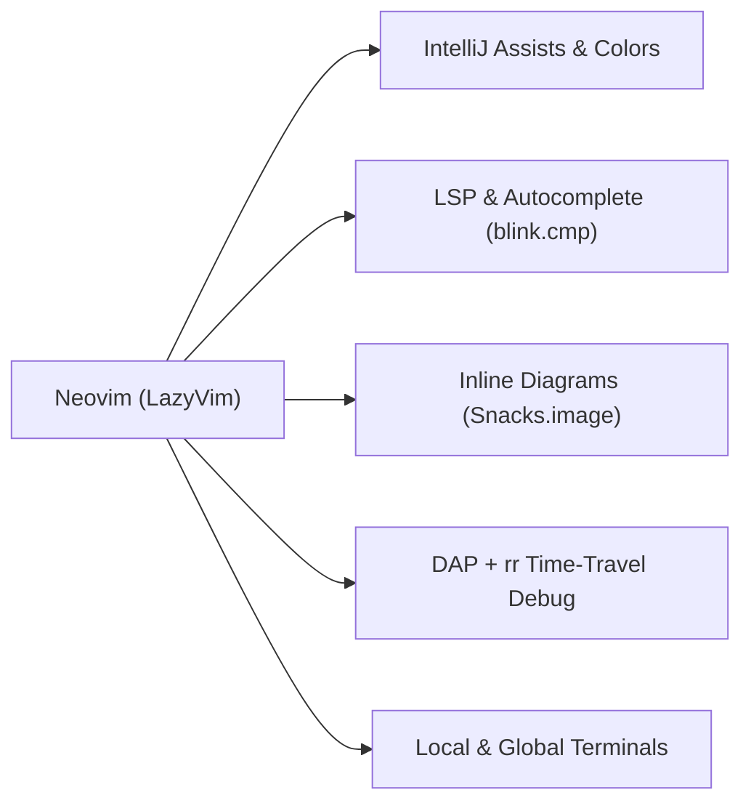

# editor-dotfiles

One repo, one command — consistent nvim-style keybindings and settings
across **Neovim, Zed, JetBrains (IntelliJ IDEA / GoLand / …) and the
VSCode family (VS Code, Cursor, Windsurf, Antigravity, VSCodium)**, with a
cross-platform idempotent Go installer.

Repo: `github.com/sebishogun/Zed-Config`

## Quick start

```sh
git clone https://github.com/sebishogun/Zed-Config.git
cd Zed-Config
make install        # set up every editor, install missing ones, idempotent
```

Subsets / preview:

```sh
make zed            # or: jetbrains | vscode | nvim
make dry            # show actions, change nothing
make help           # all targets
```

## Layout

```
zed/config/         settings.json, keymap.json, tasks.json -> ~/.config/zed/
zed/docs/           Zed 1.2.5 keymap guide
jetbrains/.ideavimrc                                       -> ~/.ideavimrc   (all JetBrains IDEs)
vscode/             settings.json, keybindings.json        -> each installed fork's User/
nvim/               full Neovim (LazyVim) config           -> ~/.config/nvim
nvim/COMMANDS.md    complete Neovim commands & keymaps reference
COMMANDS.md         complete Neovim commands & keymaps reference (root copy)
installer/          single Go binary, all targets (mise-first + OS pkg fallback)
Makefile
```

## How it works

`make install` runs the Go installer which, per target:

- **Detects `mise` and the OS/distro** package manager (`mise` preferred for CLI/runtime tools like `neovim`, `ripgrep`, `fd`, `lazygit`, `tree-sitter`, `mmdc`, with `pacman`/`apt`/`dnf`/`zypper`/`apk`/`brew`/`winget` for system packages).
- **Installs the editor if missing** (Zed, Neovim). JetBrains IDEs and
  VSCode forks are not auto-installed — config is linked for whichever are
  present.
- **Symlinks configs from this repo** into each editor's real config
  location, so edits here are live everywhere and `git pull` updates all
  machines.

### Idempotent & safe

Re-running is safe:

- Config already symlinked to this repo → skipped.
- A real (non-symlink) file/dir at the target → moved to
  `*.bak-<timestamp>` before the symlink is made. Nothing is overwritten.

---

## Neovim — Complete Commands & Keymaps Reference (by Section)

> **Leader Key:** `<Space>` (`<leader>`) — Full standalone reference also in [`COMMANDS.md`](COMMANDS.md) and [`nvim/COMMANDS.md`](nvim/COMMANDS.md).



### 1. IntelliJ Assists, Inlay Hints, Type Panels & Autocomplete
*(Configured in [`nvim/lua/plugins/intellij-assists.lua`](nvim/lua/plugins/intellij-assists.lua))*

#### Keymaps
| Keymap | Mode | Action |
| :--- | :---: | :--- |
| **`<leader>uI`** | `n` | **Open IntelliJ Assists Control Menu** (interactive picker for hints, hover, completion) |
| **`<leader>uA`** | `n` | **Master Toggle All Assists** (Inlay Hints + Auto-Hover + Autocomplete at once) |
| **`<leader>uh`** | `n` | **Toggle Inlay Hints** on / off |
| **`<leader>uH`** | `n` | **Cycle Inlay Hints Mode**: `spaced` → `caret` (caret-pause line only) → `eol` (end of line) → `off` |
| **`<leader>uk`** | `n` | **Toggle Auto-Hover Type Panel** (shows floating type/doc panel when caret pauses ~450ms) |
| **`<leader>ua`** | `n` | **Toggle Autocomplete While Typing** on / off |
| **`K`** | `n` | **Show Floating Type & Documentation Panel** at cursor (press `K` again to focus/scroll inside popup) |
| **`<leader>ci`** | `n` | **Show Type & Documentation Info Panel** on demand |
| **`<leader>ct`** | `n` | **Goto Type Definition** of variable/symbol under cursor |
| **`<M-CR>`** (`Alt+Enter`) | `n, v, i` | **Code Actions Menu** (IntelliJ `Alt+Enter` equivalent) |
| **`<leader>ca`** | `n, v` | **Code Actions Menu** |
| **`gK`** / **`<C-k>`** | `n` / `i` | **Show Function Signature Help** panel above cursor |
| **`<leader>u+`** / **`<leader>u-`** | `n` | **Zoom In / Zoom Out** terminal font size |
| **`<leader>uz`** | `n` | **Reset Terminal Zoom** to default |

#### Autocomplete Popup (`blink.cmp` — Insert Mode)
| Keymap | Mode | Action |
| :--- | :---: | :--- |
| **`<Tab>`** / **`<Down>`** | `i` | Select next completion item / jump forward in snippet |
| **`<S-Tab>`** / **`<Up>`** | `i` | Select previous completion item / jump backward in snippet |
| **`<CR>`** (`Enter`) | `i` | Accept selected completion item (with auto-brackets) |
| **`<C-Space>`** | `i` | Force open completion menu & documentation side panel |
| **`<C-e>`** | `i` | Hide / dismiss completion menu |

#### Ex Commands
| Command | Description |
| :--- | :--- |
| **`:IntelliJAssists`** | Open the interactive IntelliJ Assists & Type Hints control menu |
| **`:IntelliJAssistsToggle`** | Master toggle for all IntelliJ assists (Inlay Hints + Auto-Hover + Autocomplete) |
| **`:InlayHintsToggle`** | Toggle LSP Inlay Hints on or off |
| **`:InlayHintsMode [spaced\|caret\|eol\|off]`** | Cycle or explicitly set the Inlay Hints display mode |
| **`:AutoHoverToggle`** | Toggle automatic floating Type/Doc panel when caret rests on a symbol |
| **`:AutocompleteToggle`** | Toggle autocomplete popup while typing on or off |
| **`:ZoomIn [steps]`** / **`:ZoomOut [steps]`** | Zoom terminal font in or out by `steps` (default `1`) |
| **`:ZoomReset`** | Reset terminal font zoom back to default |

---

### 2. Terminals — Local (Current Dir) vs Global (Initial Project Dir)
*(Configured in [`nvim/lua/config/keymaps.lua`](nvim/lua/config/keymaps.lua) and [`nvim/lua/config/options.lua`](nvim/lua/config/options.lua))*

| Keymap | Mode | Action |
| :--- | :---: | :--- |
| **`Ctrl + /`** (`<C-/>`) | `n, t` | **Toggle Local Terminal** — opens in the **current file's directory** (or selected Neo-tree directory) |
| **`Ctrl + Shift + /`** (`<C-S-/>` / `<C-?>`) | `n, t` | **Toggle Global Terminal** — opens in the **initial directory where Neovim was first launched** |
| **`<leader>ft`** | `n` | Toggle Local Terminal (current buffer directory) |
| **`<leader>fT`** | `n` | Toggle Global Terminal (initial launch directory) |
| **`<Esc><Esc>`** | `t` | Double-Escape inside terminal to switch to Normal mode |
| **`q`** | `n` (in term) | Hide terminal window |

---

### 3. Markdown, Mermaid & Diagram Rendering
*(Configured in [`nvim/lua/plugins/render-markdown.lua`](nvim/lua/plugins/render-markdown.lua) and [`nvim/after/queries/markdown/images.scm`](nvim/after/queries/markdown/images.scm))*

Supports inline rendering of **Mermaid** (` ```mermaid `), **Graphviz / DOT** (` ```dot ` / ` ```graphviz `), **LaTeX Math** (`$...$` and `$$...$$`), and **Images / PDFs** directly inside Ghostty and Kitty.

| Keymap / Command | Mode | Action |
| :--- | :---: | :--- |
| **`<leader>mr`** | `n` | **Toggle Markdown Rendering** (`:RenderMarkdown toggle`) |
| **`<leader>md`** | `n` | **Hover / Zoom Diagram or Image** at cursor in a floating window (`Snacks.image.hover()`) |
| **`:RenderMarkdown toggle`** | Cmd | Enable/disable inline Markdown conceals, tables, callouts, and headings |

---

### 4. File Navigation, Search & Harpoon
*(Configured via `Snacks.picker`, `neo-tree.nvim`, and [`nvim/lua/plugins/harpoon.lua`](nvim/lua/plugins/harpoon.lua))*

#### Files & Search
| Keymap | Mode | Action |
| :--- | :---: | :--- |
| **`<leader>e`** | `n` | Toggle Neo-tree File Explorer (Root Dir) |
| **`<leader>E`** | `n` | Toggle Neo-tree File Explorer (cwd) |
| **`<leader><space>`** | `n` | Find Files (Root Dir) |
| **`<leader>ff`** | `n` | Find Files (Root Dir) |
| **`<leader>fF`** | `n` | Find Files (cwd) |
| **`<leader>fg`** | `n` | Find Git-tracked Files |
| **`<leader>fr`** | `n` | Recent Files |
| **`<leader>/`** or **`<leader>sg`** | `n` | Live Grep across project |
| **`<leader>sw`** | `n, v` | Search word / visual selection under cursor |
| **`<leader>ss`** | `n` | Go to Symbol in current file (LSP Document Symbols) |
| **`<leader>sS`** | `n` | Go to Symbol across workspace (LSP Workspace Symbols) |
| **`<leader>sr`** | `n` | Search and Replace across project (`grug-far.nvim`) |

#### Harpoon Quick File Jumping
| Keymap | Mode | Action |
| :--- | :---: | :--- |
| **`<leader>a`** | `n` | **Harpoon Add** current file |
| **`<leader>h`** | `n` | **Harpoon Quick Menu** (view/reorder pinned files) |
| **`<leader>1`** .. **`<leader>9`**, **`<leader>0`** | `n` | Jump directly to Harpoon file **1 – 10** (also supports numpad `<leader><k1>`..`<k0>`) |
| **`<leader>[`** / **`<leader>]`** | `n` | Jump to **Previous / Next** Harpoon file |

---

### 5. LSP, Code Navigation & Refactoring
*(Configured in [`nvim/lua/plugins/lsp.lua`](nvim/lua/plugins/lsp.lua) and [`nvim/lua/plugins/treesitter.lua`](nvim/lua/plugins/treesitter.lua))*

#### LSP Navigation & Actions
| Keymap | Mode | Action |
| :--- | :---: | :--- |
| **`gd`** | `n` | **Goto Definition** |
| **`gr`** | `n` | **Find References** |
| **`gI`** | `n` | **Goto Implementation** |
| **`gy`** or **`<leader>ct`** | `n` | **Goto Type Definition** |
| **`gD`** | `n` | **Goto Declaration** |
| **`K`** or **`<leader>ci`** | `n` | **Hover Type & Documentation Panel** |
| **`gK`** / **`<C-k>`** | `n` / `i` | **Signature Help** (parameter types popup) |
| **`<leader>cr`** | `n` | **Rename Symbol** across project |
| **`<leader>ca`** or **`<M-CR>`** | `n, v` | **Code Actions** |
| **`<leader>cf`** | `n, v` | **Format Buffer / Selection** (`conform.nvim`) |
| **`<leader>cd`** | `n` | Show **Line Diagnostics** in floating window |
| **`]d`** / **`[d`** | `n` | Next / Previous Diagnostic |
| **`]e`** / **`[e`** | `n` | Next / Previous Error |
| **`<leader>xx`** | `n` | Toggle **Trouble Diagnostics** panel |
| **`<leader>cs`** | `n` | Toggle **Trouble Symbols** sidebar |

#### Tree-sitter Textobjects & Structural Motions
| Keymap | Mode | Action |
| :--- | :---: | :--- |
| **`af`** / **`if`** | `x, o` | Select **outer / inner function** (`daf`, `cif`, `vaf`) |
| **`ac`** / **`ic`** | `x, o` | Select **outer / inner class or struct** |
| **`al`** / **`il`** | `x, o` | Select **outer / inner loop** |
| **`aa`** / **`ia`** | `x, o` | Select **outer / inner parameter/argument** |
| **`]m`** / **`[m`** | `n, x, o` | Jump to **next / previous function start** |
| **`]M`** / **`[M`** | `n, x, o` | Jump to **next / previous function end** |
| **`]]`** / **`[[`** | `n, x, o` | Jump to **next / previous class/struct start** |
| **`<S-Left>`** / **`<S-Right>`** | `v` | **Outdent / Indent** visual selection while keeping selection active |

---

### 6. Debugging (DAP) & `rr` Time-Travel Debugging
*(Configured in [`nvim/lua/plugins/dap.lua`](nvim/lua/plugins/dap.lua) and [`nvim/lua/plugins/rr.lua`](nvim/lua/plugins/rr.lua))*

#### Standard Debugging (`<leader>d`)
| Keymap | Mode | Action |
| :--- | :---: | :--- |
| **`<leader>db`** | `n` | **Toggle Breakpoint** |
| **`<leader>dB`** | `n` | **Set Conditional Breakpoint** |
| **`<leader>dc`** | `n` | **Continue / Start Debugging** |
| **`<leader>di`** | `n` | **Step Into** |
| **`<leader>do`** | `n` | **Step Over** |
| **`<leader>dO`** | `n` | **Step Out** |
| **`<leader>dr`** | `n` | **Restart Debug Session** |
| **`<leader>dl`** | `n` | **Run Last Debug Configuration** |
| **`<leader>dp`** | `n` | **Pause Thread** |
| **`<leader>dt`** | `n` | **Terminate Debug Session** |
| **`<leader>du`** | `n` | **Toggle DAP UI Panels** (Scopes, Stacks, Watches, REPL, Console) |
| **`<leader>de`** | `n, v` | **Evaluate Expression** under cursor / selection |

#### `rr` Time-Travel / Reverse Debugging (Linux — Rust, C, C++, Zig)
| Keymap / Command | Mode | Action |
| :--- | :---: | :--- |
| **`:RRRecord [binary] [args...]`** | Cmd | Record execution of a binary with `rr record` |
| **`:RRReplay [port]`** | Cmd | Start `rr replay` server (default port `50505`), then attach via `<leader>dc` |
| **`:RRStop`** | Cmd | Stop the background `rr replay` server |
| **`<leader>dRc`** | `n` | **Reverse Continue** (run backwards to previous breakpoint/watchpoint) |
| **`<leader>dRi`** | `n` | **Reverse Step Into** |
| **`<leader>dRo`** | `n` | **Reverse Step Over** |
| **`<leader>dRO`** | `n` | **Reverse Step Out** |

---

### 7. Rust Development (`rustaceanvim`)
*(Configured in [`nvim/lua/plugins/rust.lua`](nvim/lua/plugins/rust.lua) and [`nvim/after/ftplugin/rust.lua`](nvim/after/ftplugin/rust.lua) — active in `.rs` buffers)*

| Keymap | Mode | Action |
| :--- | :---: | :--- |
| **`<leader>rr`** / **`<leader>rR`** | `n` | **Run** target at cursor / **Re-run last** |
| **`<leader>rd`** / **`<leader>rD`** | `n` | **Debug** target at cursor / **Re-debug last** |
| **`<leader>rt`** / **`<leader>rT`** | `n` | **Test** at cursor / **Re-test last** |
| **`<leader>ra`** | `n` | **Rust Code Actions** |
| **`<leader>rh`** or **`K`** | `n` | **Rust Hover Actions** |
| **`<leader>re`** / **`<leader>rE`** | `n` | **Explain Error** / **Render Diagnostic** |
| **`<leader>ry`** | `n` | **Copy Line Diagnostic(s)** to system clipboard |
| **`<leader>rm`** / **`<leader>rp`** | `n` | **Expand Macro** / **Rebuild Proc Macros** |
| **`<leader>rc`** / **`<leader>ro`** | `n` | **Open `Cargo.toml`** / **Open `docs.rs`** for symbol |
| **`<leader>ru`** | `n` | Go to **Parent Module** |
| **`<leader>rj`** | `n, v` | **Join Lines** (Rust-aware) |
| **`<leader>rs`** | `n` | **Structural Search & Replace** (`ssr`) |
| **`<leader>rg`** | `n` | View **Crate Graph** |
| **`<leader>rv`** / **`<leader>rV`** | `n` | View **HIR** / **MIR** |
| **`<leader>rf`** | `n` | Run manual **Fly Check** (`cargo clippy`) |

---

### 8. LaTeX (`VimTeX` + `texlab`) & Locality
*(Configured in [`nvim/lua/plugins/tex.lua`](nvim/lua/plugins/tex.lua), [`nvim/lua/plugins/lsp.lua`](nvim/lua/plugins/lsp.lua), and [`nvim/lua/plugins/locality.lua`](nvim/lua/plugins/locality.lua))*

#### LaTeX (`VimTeX` — in `.tex` files)
| Keymap / Command | Mode | Action |
| :--- | :---: | :--- |
| **`\ll`** (`:VimtexCompile`) | `n` | Start / toggle continuous `latexmk` PDF compilation |
| **`\lv`** (`:VimtexView`) | `n` | Forward-search current line in `sioyek` / `zathura` |
| **`\lk`** (`:VimtexStop`) | `n` | Stop compilation |
| **`\le`** (`:VimtexErrors`) | `n` | Open quickfix error list |
| **`\lc`** (`:VimtexClean`) | `n` | Clean auxiliary build files |
| **`\lt`** (`:VimtexTocToggle`) | `n` | Toggle Table of Contents sidebar |

#### Locality Commands
| Command | Description |
| :--- | :--- |
| **`:LocalityStats`** / **`:LocalityDetect`** | Run Locality analysis & detection |
| **`:LocalityPhaseA`** / **`:LocalityPhaseB`** | Run Locality Phase A / Phase B |
| **`:LocalityBrowse`** / **`:LocalityViewer`** | Open Locality browser / viewer |
| **`:LocalityGraph`** / **`:LocalityTreemap`** / **`:LocalityFlame`** | Open Locality Graph, Treemap, or Flame visualizations |

---

### 9. Git, Windows, Buffers & Plugin Management

#### Git (`LazyGit` & `gitsigns.nvim`)
| Keymap | Mode | Action |
| :--- | :---: | :--- |
| **`<leader>gg`** | `n` | Open **LazyGit** (floating UI) |
| **`<leader>gf`** | `n` | Open LazyGit for current file history |
| **`<leader>gb`** / **`<leader>ghb`** | `n` | Git Blame Line |
| **`]h`** / **`[h`** | `n` | Next / Previous Git Hunk |
| **`<leader>ghs`** / **`<leader>ghr`** | `n, v` | Stage / Reset Git Hunk |
| **`<leader>ghp`** | `n` | Preview Git Hunk inline |

#### Buffers & Windows
| Keymap / Command | Mode | Action |
| :--- | :---: | :--- |
| **`<S-h>`** / **`<S-l>`** | `n` | Previous / Next Buffer tab |
| **`<leader>bd`** | `n` | Delete current buffer |
| **`<leader>bo`** | `n` | Delete all other buffers |
| **`<C-h>` `<C-j>` `<C-k>` `<C-l>`** | `n` | Move focus between left / lower / upper / right splits |
| **`<leader>-`** / **`<leader>\|`** | `n` | Split window below / right |
| **`<leader>wd`** | `n` | Close current window split |
| **`:Lazy`** | Cmd | Open Lazy plugin manager (`S` to sync, `U` to update) |
| **`:Mason`** | Cmd | Open Mason LSP / DAP / Formatter installer |
| **`:LspInfo`** / **`:ConformInfo`** | Cmd | Inspect attached LSP servers / active code formatters |

---

## Project debugger profiles

Keep project-specific launch profiles in the project's `.vscode/launch.json`.
VS Code reads that file natively, current nvim-dap discovers it through its
built-in configuration provider, and Zed imports it when the project does not
define `.zed/debug.json`. The shared `space d ...` controls operate on the
profile loaded by each editor; this repository does not duplicate project
profiles in user-level configuration.

## Platform support

| OS | Editor install | Config path |
|----|----------------|-------------|
| Linux (arch/debian/fedora/suse/alpine) | `mise` + distro pkg mgr | `~/.config/...`, `~/.ideavimrc` |
| macOS | `mise` + Homebrew | `~/.config/zed`, `~/Library/Application Support/<fork>/User`, `~/.ideavimrc` |
| Windows | `mise` + winget | `%APPDATA%`, `%LOCALAPPDATA%\nvim`, `~/.ideavimrc` |
